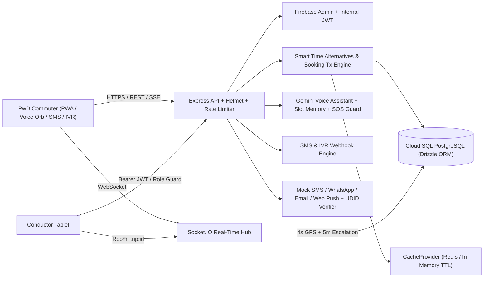

# SahayYatra — Accessible Transit Platform ("Every journey, for everyone")

SahayYatra is an accessible government-bus booking platform built for persons with disabilities (PwD), pairing a WCAG AAA / voice-first React PWA frontend with a Node.js + Express + PostgreSQL + Socket.IO + Google Gemini backend.

## Architecture Diagram



## Quick Start

1. Copy `.env.example` to `.env` and set `GEMINI_API_KEY` and database connection credentials (`SQL_HOST`, `SQL_USER`, `SQL_PASSWORD`, `SQL_DB_NAME`), or launch local Postgres + Redis via Docker Compose:
   ```bash
   docker compose up -d
   ```
2. Install dependencies & seed the database:
   ```bash
   npm install
   npm run seed
   ```
3. Run development server (Express API + Socket.IO + Swagger UI + Vite PWA on port `3000`):
   ```bash
   npm run dev
   ```
4. Open Swagger / OpenAPI interactive documentation at `http://localhost:3000/api/docs`.
5. Run backend unit & concurrency tests:
   ```bash
   npm test
   ```

## Core API Endpoints

| Area | Endpoint | Purpose |
| --- | --- | --- |
| Auth | `POST /api/auth/otp/request`, `POST /api/auth/otp/verify`, `POST /api/auth/refresh`, `POST /api/auth/guest` | OTP login, JWT token rotation, companion/guest sessions |
| Profile & DPDP | `GET/PATCH/DELETE /api/profile`, `GET /api/profile/export`, `POST /api/profile/udid/verify` | Encrypted disability needs, UDID 50% concession verification, DPDP export & erasure |
| Discovery | `GET /api/stops`, `GET /api/routes`, `GET /api/trips/search?from=&to=&time=&needs=` | Tactile/ramp stop metadata & **Smart Time Alternatives** (exact, earlier, later, score) |
| Bookings | `POST /api/bookings`, `POST /api/bookings/:id/cancel`, `POST /api/bookings/:id/undo`, `POST /api/bookings/:id/check-in`, `POST /api/waitlist` | Row-locked `SELECT FOR UPDATE` last wheelchair bay allocation, 30s undo, FIFO waitlist promotion |
| In-Journey | `POST /api/bookings/:id/running-late`, `POST /api/bookings/:id/request-stop`, `POST /api/bookings/:id/message-conductor` | Real-time Socket.IO signals to conductor tablet |
| Conductor | `GET /api/conductor/manifest/:tripId`, `POST /api/conductor/ack/:bookingId`, `POST /api/conductor/board/:bookingId`, `POST /api/conductor/no-show/:bookingId` | Consent-respecting PwD manifest + 5-min auto-escalation to depot |
| SOS | `POST /api/sos`, `POST /api/sos/:id/resolve`, `POST /api/sos/:id/cancel` | Multi-channel SMS/WhatsApp/Email/Push alert + live trip broadcast |
| Voice (Gemini) | `POST /api/voice/intent`, `POST /api/voice/stream`, `POST /api/voice/tts-text` | Validated Gemini NLU (`GEMINI_MODEL`), prompt-injection sanitization, SSE stream, SSML formatting |
| Fallback Channels | `POST /api/channels/sms`, `POST /api/channels/ivr` | Feature-phone SMS (`BOOK`, `STATUS`) & DTMF/speech helpline |
| Demo & Ops | `POST /api/admin/simulate/{delay,cancel,fill,sos}`, `POST /api/admin/reset`, `GET /api/admin/analytics` | Live demo simulation, database re-seed, audit metrics |

## Security & DPDP Compliance

- **PII Encryption at Rest**: Disability needs are encrypted with AES-256-GCM (`src/server/utils/crypto.ts`) before persistence in PostgreSQL.
- **Consent-Aware Conductor Manifest**: When a passenger sets `consentShareNeed = false`, conductors only see `assistanceNeeded: true` while specific disability categories remain hidden (`disclosedNeeds: null`).
- **Prompt Injection Defense**: `sanitizeTranscript()` strips control tokens and override phrases before passing speech transcripts to Gemini, and distress terms (`help`, `emergency`, `आपातकाल`, `জরুরি`) trigger immediate deterministic SOS routing.
- **Audit Logging & Rate Limiting**: Sensitive auth, profile, booking, and SOS operations emit structured JSON logs and immutable rows in `audit_logs`.
